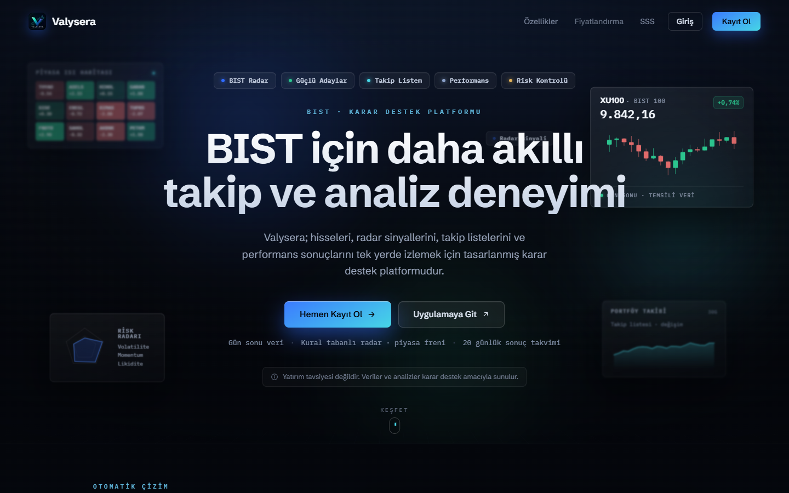
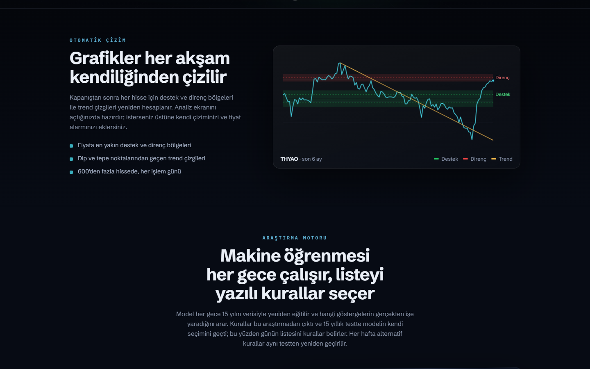
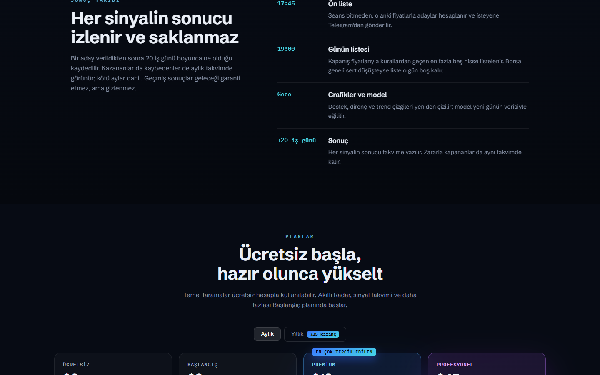
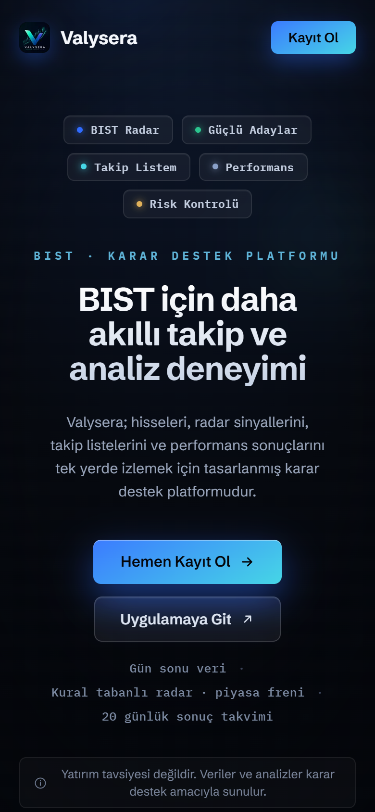

# Valysera

**A decision support platform for Borsa Istanbul (BIST) stocks, built on written rules and honest results.**

Most stock signal services in Turkey show you their best trades and quietly drop the rest. I wanted the opposite: a system whose rules are written down, whose every signal is tracked for 20 trading days, and whose bad months stay on the calendar next to the good ones. Valysera is that system. It scans 600+ BIST stocks every trading day, picks at most five candidates with fixed rules, and stops giving signals entirely when the market as a whole is falling hard.

It's live at [valysera.com](https://www.valysera.com) with free and paid plans.

> This repository is a showcase. The source code, models and data are private.

  

  

  
  

## What it does

### Signals
- **Rule-based radar.** Each trading day, end-of-day prices go through a written rule set. At most five stocks make the list. The rules are documented in one place and run in one engine, so the backtest and the live system can't drift apart.
- **Market brake.** When the broad market drops sharply over a short window, the system gives no new signals at all and tells subscribers why, instead of buying into a crash.
- **Early list at 17:45.** Before the session closes, candidates are computed from live prices and sent to Telegram, so there's time to act on the same day.
- **Machine learning as research, not as the picker.** A model is retrained every night on 15 years of data to find which indicators actually matter. In testing, the written rules beat the model's own picks, so the rules choose the list and the model informs the research.

### Tracking and transparency
- **Every signal is followed for 20 trading days** and written to a monthly results calendar. Losing signals stay visible.
- **Paper portfolio ledger.** A model portfolio follows the rules day by day with real prices, as a persistent ledger: positions and cash carry over, each day only applies that day's events.
- **Personal portfolio tracking** with an accounting view: value over time, comparison with the market, monthly table.

### Analysis tools
- Support, resistance and trend lines redrawn automatically every evening for every stock, with your own drawings and price alarms on top.
- Scans: bottom reversal, volume and price, 52-week high and low, seasonality, breakout after quiet periods.
- Favorites, notes and a watch list.

### Notifications and integrations
- **Telegram bot** with the daily list, market brake alerts, favorites and price alarms, configurable per user.
- **AI assistant connection.** An MCP server with OAuth 2.1 lets users ask Claude or ChatGPT about their own radar, favorites and watch list through read-only tools.

## How it's built

| | |
|---|---|
| Web app | Next.js 16 (App Router), React 19, TypeScript, Tailwind CSS 4, Motion, Lightweight Charts |
| Backend | Supabase: Postgres, Auth, Storage, Edge Functions and row-level security |
| Data and signals | Python, pandas, scikit-learn, running on a VPS with scheduled daily jobs |
| Hosting | Vercel for the web app, a Linux VPS for the data pipeline |
| Payments | Creem, with signed webhooks |
| Notifications | Telegram Bot API, Resend for email |
| Monitoring | Dead-man's-switch health checks for every scheduled job, plus a daily system check that reports problems to me |

A few things I cared about:
- **One engine, one rule book.** The rules live in a single module that both the backtest and the live ledger call. An earlier version had two implementations that disagreed; merging them fixed a whole class of bugs.
- **Measure, don't assume.** Every rule change is checked with a before/after script that compares a hash of the full trade history, so an unrelated change can never silently move the results.
- **Access rules live in the database.** Subscription tiers, notification settings and who can read what are enforced with Postgres row-level security and server functions, not only in the UI.
- **Honest numbers.** Backtests include survivorship bias warnings and realistic entry assumptions (limit-up days, next-day entries). The public site shows no return claims.

## Status

- [x] Rule-based radar, market brake and 20-day results calendar
- [x] Paper portfolio ledger and personal portfolio tracking
- [x] Automatic chart drawing, scans and price alarms
- [x] Telegram bot and per-user notification settings
- [x] Subscriptions, cancellation and legal pages (terms, privacy, refunds)
- [x] MCP server for Claude and ChatGPT
- [ ] Referral program
- [ ] Real-time intraday data source

## Note

Valysera is a decision support tool. It does not provide investment advice, and nothing on the site or in this repository is a recommendation to buy or sell any security. Past performance is not a guarantee of future results.

## License

Copyright (c) 2026 Baris Alkan. All rights reserved. The text and images in this repository may not be copied, modified or reused without my written permission. See [LICENSE](LICENSE).
